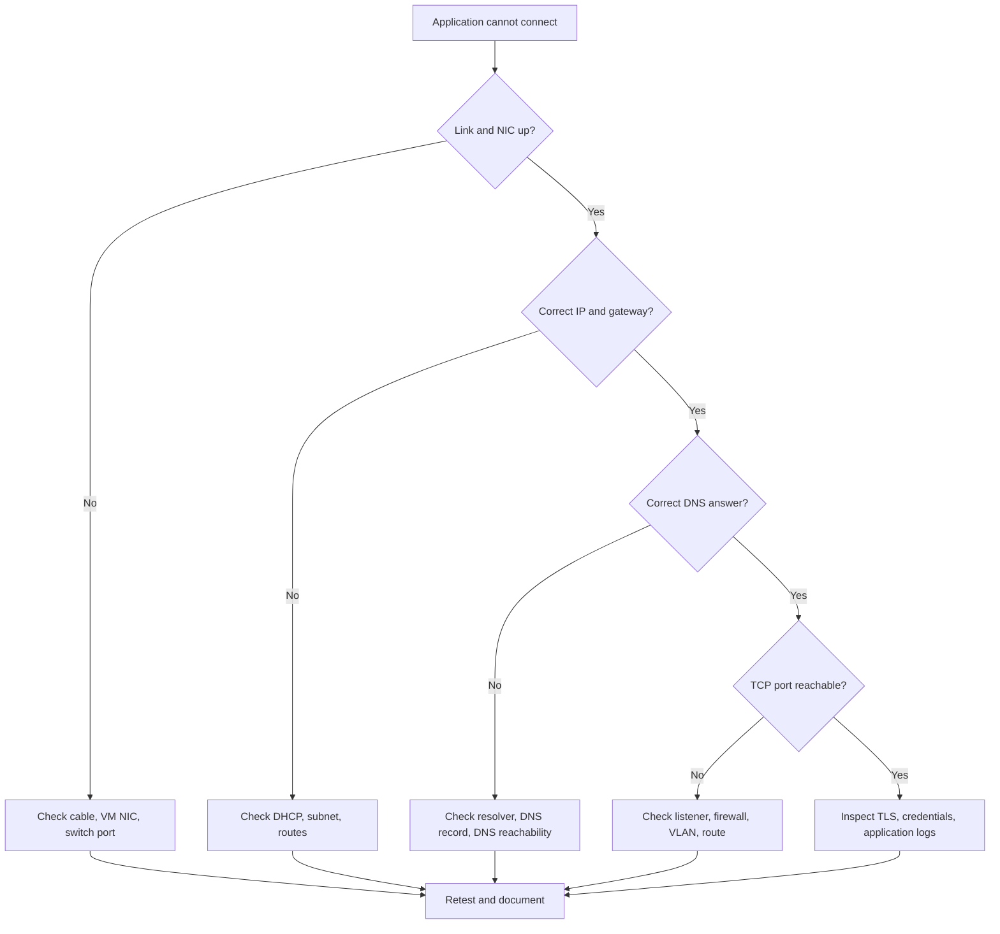

# Network Troubleshooting Tools and How to Use Them

**IT 101 → Expert | Hands-on reference for Windows, Linux, Proxmox, pfSense, and managed switches**

> Run scans and packet captures only on systems and networks you own or are authorized to administer. Examples use documentation IP ranges or an isolated lab. Do not disable production firewalls to diagnose a problem.

## Contents
1. [Build a practice lab](#1-build-a-practice-lab)
2. [A repeatable troubleshooting workflow](#2-a-repeatable-troubleshooting-workflow)
3. [Tool selection quick reference](#3-tool-selection-quick-reference)
4. [Physical and link layer](#4-physical-and-link-layer)
5. [IP addresses, gateways, and routes](#5-ip-addresses-gateways-and-routes)
6. [Ping and path tracing](#6-ping-and-path-tracing)
7. [DNS diagnosis](#7-dns-diagnosis)
8. [Ports, listeners, and service checks](#8-ports-listeners-and-service-checks)
9. [ARP, neighbors, and VLANs](#9-arp-neighbors-and-vlans)
10. [Packet capture with tcpdump and Wireshark](#10-packet-capture-with-tcpdump-and-wireshark)
11. [Throughput and performance](#11-throughput-and-performance)
12. [Authorized discovery with Nmap](#12-authorized-discovery-with-nmap)
13. [Proxmox troubleshooting](#13-proxmox-troubleshooting)
14. [pfSense troubleshooting](#14-pfsense-troubleshooting)
15. [Cisco-style switch troubleshooting](#15-cisco-style-switch-troubleshooting)
16. [Bash diagnostic script](#16-bash-diagnostic-script)
17. [PowerShell diagnostic script](#17-powershell-diagnostic-script)
18. [Ten hands-on labs](#18-ten-hands-on-labs)
19. [Troubleshooting decision tree](#19-troubleshooting-decision-tree)
20. [Completion checklist and references](#20-completion-checklist-and-references)

## 1. Build a practice lab

Use your existing Proxmox cyber range. Suggested addressing (adjust to your environment):

| System | Address | Network | Purpose |
|---|---|---|---|
| pfSense LAN | `10.10.20.1/24` | `vmbr20` | Gateway/firewall |
| Ubuntu Server | `10.10.20.10/24` | `vmbr20` | SSH, DNS, web test target |
| Windows 11 | `10.10.20.20/24` | `vmbr20` | Windows diagnostics |
| Kali | `10.10.10.10/24` | `vmbr10` | Authorized lab testing |
| pfSense Kali interface | `10.10.10.1/24` | `vmbr10` | Lab routing |

The networks should be isolated from your management network. Allow inter-network traffic only through explicit pfSense rules. A failed ping can be the **correct** outcome if the firewall is intentionally blocking it.

Install common Ubuntu tools:

```bash
sudo apt update
sudo apt install -y iproute2 iputils-ping traceroute dnsutils curl netcat-openbsd \
  tcpdump iperf3 ethtool mtr-tiny nmap
```

On Windows, use built-in PowerShell, `ping`, `tracert`, `nslookup`, and `netsh`; install Wireshark from its official website if needed.

## 2. A repeatable troubleshooting workflow

1. **Define the symptom:** one device, one application, one VLAN, or the entire site?
2. **Record baseline:** time, source, destination, IP, DNS name, expected port, and recent changes.
3. **Check local link:** interface up, cable/virtual NIC connected, switch port correct.
4. **Check addressing:** IP, prefix, gateway, DNS, DHCP lease.
5. **Check local network:** gateway reachability and neighbor/ARP table.
6. **Check routing:** correct next hop and firewall path.
7. **Check DNS:** name resolves to the expected address.
8. **Check transport:** target TCP/UDP service reachable and listening.
9. **Capture packets** when earlier tests disagree or a handshake fails.
10. **Fix one cause at a time**, retest, document the root cause and prevention.

**Do not assume:** ping failure means a host is down; many hosts block ICMP. Successful ping does not prove that HTTPS, SSH, or DNS works.

## 3. Tool selection quick reference

| Symptom | Windows | Linux | What to look for |
|---|---|---|---|
| No IP address | `ipconfig /all` | `ip -br addr` | Missing lease, wrong subnet |
| Can't reach gateway | `ping <gateway>` | `ping -c 4 <gateway>` | Link/VLAN/gateway issue |
| Wrong route | `route print` | `ip route` | Wrong default route |
| Name fails | `Resolve-DnsName example.com` | `dig example.com` | DNS response/server |
| Port inaccessible | `Test-NetConnection <ip> -Port 22` | `nc -vz <ip> 22` | TCP connection success/failure |
| Service not listening | `Get-NetTCPConnection -State Listen` | `ss -lntp` | Bound address/port |
| Path uncertain | `tracert <ip>` | `tracepath <ip>` | Where replies stop (not always a fault) |
| Packet loss | `ping -n 20 <ip>` | `mtr -rw -c 20 <ip>` | End-to-end loss |
| Slow transfer | `iperf3` | `iperf3` | Throughput, retransmits |
| Need packets | Wireshark | `tcpdump` | SYN/SYN-ACK, DNS, ICMP |

## 4. Physical and link layer

### Windows

```powershell
Get-NetAdapter | Format-Table Name, Status, LinkSpeed, MacAddress
Get-NetAdapterStatistics -Name 'Ethernet'
```

Expected: adapter `Up`, plausible link speed, errors not increasing rapidly. Wireless and VM adapter names vary.

### Linux

```bash
ip -br link
sudo ethtool ens18
ip -s link show dev ens18
```

Replace `ens18` with the actual interface. A virtual NIC may not expose all physical link details via `ethtool`.

**If down:** check Proxmox VM Hardware → Network Device → Connected, physical cable, switch port state, or guest driver. **If errors increase:** inspect cable, duplex, physical NIC, switch counters, and congestion.

## 5. IP addresses, gateways, and routes

### Windows

```powershell
ipconfig /all
Get-NetIPConfiguration
route print
Get-NetRoute -AddressFamily IPv4 | Sort-Object RouteMetric
```

A `169.254.x.x` address often indicates DHCP was unavailable (APIPA). Confirm DHCP service, VLAN, and relay before renewing a lease.

```powershell
ipconfig /release
ipconfig /renew
```

Use renewal only on a DHCP-managed interface; doing this remotely may disconnect you.

### Linux

```bash
ip -br addr
ip route
ip route get 10.10.20.1
resolvectl status
```

`ip route get` reveals the selected source interface and next hop for a destination. On systems without `systemd-resolved`, `resolvectl` may not exist.

**Interpretation:** if your VM is `10.10.20.10/24`, its gateway should usually be in `10.10.20.0/24` (for example `10.10.20.1`). Verify there is only one intended default route.

## 6. Ping and path tracing

### Ping

```powershell
ping 10.10.20.1
ping -n 10 10.10.20.10
```

```bash
ping -c 4 10.10.20.1
ping -c 20 10.10.20.10
```

A reply with a time value confirms that ICMP echo responses reached you. `Request timed out` can mean filtering, host failure, or routing trouble. `Destination host unreachable` often indicates a routing or neighbor-resolution problem; inspect the sender of that message.

### Trace route

```powershell
tracert 10.10.20.10
```

```bash
tracepath 10.10.20.10
traceroute -n 10.10.20.10
mtr -rw -c 20 10.10.20.10
```

Some routers do not respond to TTL-expired probes; a `*` at one hop does **not** necessarily mean traffic stops there. Prioritize end-to-end connectivity and loss at the destination.

## 7. DNS diagnosis

```powershell
nslookup example.com
Resolve-DnsName example.com
Resolve-DnsName example.com -Server 1.1.1.1
ipconfig /displaydns
```

```bash
dig example.com
dig @1.1.1.1 example.com A +short
dig example.com MX
getent hosts example.com
```

For an **offline lab**, query your **internal DNS server**, not public DNS. Example:

```bash
dig @10.10.20.10 dc01.corp.example.test A
```

**Read the results:** `NXDOMAIN` means the queried name does not exist in that DNS view; `SERVFAIL` indicates resolution failed; a timeout suggests the DNS server or path is unavailable. A valid answer with the wrong IP points to stale or incorrect DNS records. Compare name resolution with direct-IP access.

## 8. Ports, listeners, and service checks

### From Windows

```powershell
Test-NetConnection 10.10.20.10 -Port 22
Test-NetConnection 10.10.20.10 -Port 443
Get-NetTCPConnection -State Listen | Sort-Object LocalPort
Get-Service sshd
```

`TcpTestSucceeded : True` proves TCP connectivity to that port, not successful login or application health.

### From Linux

```bash
nc -vz -w 3 10.10.20.10 22
sudo ss -lntup
curl -I --max-time 5 http://10.10.20.10
curl -vk --max-time 5 https://10.10.20.10
```

`curl -k` disables certificate validation: use it **only as a diagnostic** and do not treat its success as proof of secure TLS.

**SSH failure checklist:** SSH service running? Listening on `0.0.0.0:22` or the correct interface? Guest firewall allowing it? pfSense pass rule? Correct VLAN and route?

## 9. ARP, neighbors, and VLANs

```powershell
arp -a
Get-NetNeighbor -AddressFamily IPv4
```

```bash
ip neigh show
ip -d link show
```

A neighbor entry in `FAILED` or `INCOMPLETE` state can indicate a Layer 2 or ARP problem. An empty entry may simply mean the host has not attempted contact yet.

**VLAN checklist:**
- VM NIC attached to the intended Proxmox bridge.
- Proxmox NIC VLAN tag matches the intended VLAN, if tagging is used.
- Physical switch port is access or trunk as designed.
- Tagged VLANs are allowed on every relevant trunk.
- pfSense interface and gateway belong to the correct subnet.
- There is no accidental double tagging (guest and hypervisor both tagging unexpectedly).

## 10. Packet capture with tcpdump and Wireshark

Packet captures can contain passwords, tokens, personal data, and internal topology. Restrict access, limit capture scope, and remove sensitive data before sharing.

### Capture DNS on Ubuntu

```bash
sudo tcpdump -ni ens18 -c 30 'udp port 53 or tcp port 53'
```

### Capture SSH handshake traffic

```bash
sudo tcpdump -ni ens18 -c 40 'host 10.10.20.20 and tcp port 22'
```

### Save a capture

```bash
sudo tcpdump -ni ens18 -s 0 -c 200 -w /tmp/ssh-test.pcap 'tcp port 22'
```

Open the `.pcap` in Wireshark. Useful **display filters**:

```text
dns
tcp.port == 22
ip.addr == 10.10.20.10
tcp.analysis.retransmission
icmp
```

**TCP interpretation:**
- SYN → SYN/ACK → ACK: TCP handshake completed.
- SYN repeated with no response: possible filtering, loss, or unreachable service.
- SYN → RST: connection actively refused, commonly no listener or a reject rule.
- DNS query with no response: check DNS service, firewall, and packet path.

Captures show observations, not necessarily the root cause. Compare captures at source and destination if needed.

## 11. Throughput and performance

Run an `iperf3` server on a **controlled test endpoint**:

```bash
iperf3 -s
```

From a client:

```bash
iperf3 -c 10.10.20.10 -t 15
iperf3 -c 10.10.20.10 -R -t 15
```

`-R` reverses the test direction. Ensure TCP port 5201 is permitted only for the lab test. Compare throughput with NIC speeds, VM CPU use, and link utilization. High bandwidth use or CPU saturation may explain latency and retransmissions.

## 12. Authorized discovery with Nmap

Use only against assigned lab targets:

```bash
nmap -sT -Pn -p 22,80,443 10.10.20.10
nmap -sV -p 22,80,443 10.10.20.10
```

`open` means the probe reached a listening service; `closed` indicates no listener responded; `filtered` suggests a network filter or lack of response. `-Pn` skips host discovery and should not be used as evidence that a host is online.

Avoid broad scans of networks you do not administer.

## 13. Proxmox troubleshooting

On the Proxmox host:

```bash
ip -br addr
ip route
bridge link
bridge vlan show
qm list
qm config 120
```

Replace VM ID `120` with yours. Review the VM NIC's `bridge=...`, `tag=...`, and model (`virtio` or `e1000`). Also inspect **Node → System → Network** and the VM's **Hardware → Network Device**.

**Common faults:** disconnected virtual NIC, wrong bridge, VLAN mismatch, duplicate IP, guest interface renamed after import, or Proxmox/guest firewall filtering. Never modify a remote Proxmox management bridge without console or out-of-band recovery access.

## 14. pfSense troubleshooting

In the pfSense web UI:

1. **Status → Interfaces:** confirm each lab NIC is up with the expected IP.
2. **Diagnostics → Ping:** test from the correct **source interface**.
3. **Diagnostics → Traceroute:** inspect routed path.
4. **Diagnostics → DNS Lookup:** check resolver behavior.
5. **Status → System Logs → Firewall:** inspect blocked/pass traffic (menu names may vary by release).
6. **Diagnostics → Packet Capture:** capture on both ingress and egress interfaces if needed.
7. **Firewall → Rules:** remember interface rules generally apply to traffic **entering** that interface.
8. **Firewall → NAT:** review only if translation is expected; inter-LAN routing normally does not require NAT.

**Critical:** the default LAN allow rule may be too broad for a cyber range. Apply explicit segmentation rules and test that targets cannot reach management devices.

## 15. Cisco-style switch troubleshooting

Commands vary by model and IOS version:

```text
show interfaces status
show interfaces counters errors
show vlan brief
show interfaces trunk
show mac address-table
show ip interface brief
show spanning-tree
show running-config interface gigabitEthernet0/1
show logging
```

**What to check:** interface administratively down, wrong access VLAN, missing allowed trunk VLAN, STP blocking, port errors, unexpected MAC location, or a missing SVI/gateway. Make configuration changes only after confirming the intended topology and maintenance window.

## 16. Bash diagnostic script

Save as `network-check.sh`:

```bash
#!/usr/bin/env bash
set -u
TARGET="${1:-10.10.20.1}"
PORT="${2:-22}"
printf '\n== Host ==\n'; hostname
printf '\n== Interfaces ==\n'; ip -br addr
printf '\n== Routes ==\n'; ip route
printf '\n== Route to target ==\n'; ip route get "$TARGET" || true
printf '\n== Ping ==\n'; ping -c 3 -W 2 "$TARGET" || true
printf '\n== TCP port ==\n'; nc -vz -w 3 "$TARGET" "$PORT" || true
printf '\n== DNS ==\n'; getent hosts example.com || true
```

Run:

```bash
chmod +x network-check.sh
./network-check.sh 10.10.20.10 22
```

Expected: interface and route data, ping statistics, and TCP success/failure. A DNS failure is expected in some offline labs; substitute an internal hostname.

## 17. PowerShell diagnostic script

Save as `Test-LabNetwork.ps1`:

```powershell
param(
  [string]$Target = '10.10.20.10',
  [int]$Port = 22
)
Write-Host '== Computer =='
$env:COMPUTERNAME
Write-Host '== IP configuration =='
Get-NetIPConfiguration | Format-List
Write-Host '== Routes =='
Get-NetRoute -AddressFamily IPv4 | Format-Table -AutoSize
Write-Host '== ICMP =='
Test-Connection -ComputerName $Target -Count 3 -ErrorAction Continue
Write-Host '== TCP =='
Test-NetConnection -ComputerName $Target -Port $Port
Write-Host '== DNS =='
Resolve-DnsName example.com -ErrorAction Continue
```

Run in PowerShell from the directory containing the file:

```powershell
.\Test-LabNetwork.ps1 -Target 10.10.20.10 -Port 22
```

If script execution is restricted, review your organization's execution policy rather than globally disabling protections. A PowerShell script should be reviewed before execution.

## 18. Ten hands-on labs

For each lab, record: **symptom → hypothesis → command → output → root cause → fix → retest**.

1. **Interface down:** disconnect a test VM NIC in Proxmox; diagnose with `ip -br link` or `Get-NetAdapter`; reconnect.
2. **Wrong subnet:** change an isolated test VM to an incorrect subnet; use `ip route` and gateway tests; restore correct settings.
3. **DHCP failure:** stop DHCP in the lab only; observe Windows lease behavior and Linux addressing; restore DHCP.
4. **Wrong DNS record:** add a temporary incorrect internal DNS record; compare `dig`/`Resolve-DnsName` with direct-IP access; fix record.
5. **SSH port blocked:** block TCP 22 in pfSense for a lab target; compare ping and `Test-NetConnection`; restore narrow allow rule.
6. **VLAN mismatch:** assign a VM to the wrong lab VLAN; use Proxmox NIC settings and switch VLAN checks; correct tag.
7. **No listener:** stop a test web service; observe `curl`/`ss` and TCP refusal; restart service.
8. **Packet capture:** record DNS and TCP handshake traffic on an authorized test VM; identify query/response and SYN/SYN-ACK/ACK.
9. **Performance baseline:** measure `iperf3` throughput in both directions; record VM CPU, throughput, and retransmissions.
10. **Incident simulation:** combine one DNS issue and one firewall issue; resolve them separately and write a short incident report.

### Sample incident report

```text
Incident ID: LAB-001
Time detected:
Affected source and destination:
Expected service and port:
Observed symptom:
Tests and evidence:
Root cause:
Corrective action:
Verification:
Prevention / monitoring:
```

## 19. Troubleshooting decision tree



**Caution:** the tree is a learning aid, not an exclusive sequence. For direct-IP access, DNS is irrelevant. Some applications use UDP or other protocols instead of TCP.

## 20. Completion checklist and references

- [ ] Identify the correct local interface and IP configuration on Windows and Linux.
- [ ] Explain the difference between a link, IP, DNS, TCP, and application failure.
- [ ] Test gateways, routing paths, and DNS without relying on ping alone.
- [ ] Verify TCP listeners and firewall rules.
- [ ] Inspect Proxmox bridges, VLAN tags, and pfSense interface rules.
- [ ] Capture and interpret a basic TCP handshake and DNS query.
- [ ] Run throughput tests on controlled endpoints.
- [ ] Run the Bash and PowerShell scripts and interpret their results.
- [ ] Complete ten labs and produce at least one incident report.

### Official documentation

- [Microsoft Test-NetConnection](https://learn.microsoft.com/en-us/powershell/module/nettcpip/test-netconnection)
- [Microsoft Get-NetIPConfiguration](https://learn.microsoft.com/en-us/powershell/module/nettcpip/get-netipconfiguration)
- [Wireshark User's Guide](https://www.wireshark.org/docs/wsug_html_chunked/)
- [Nmap Reference Guide](https://nmap.org/book/man.html)
- [Proxmox VE Administration Guide](https://pve.proxmox.com/pve-docs/)
- [pfSense Documentation](https://docs.netgate.com/pfsense/en/latest/)
- [iperf3 documentation](https://software.es.net/iperf/)

**Suggested repository path:** `networking/troubleshooting-tools/README.md`
