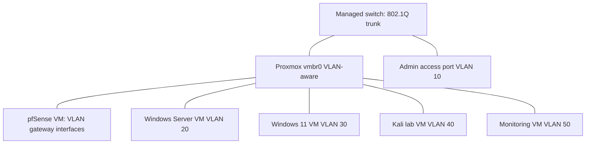

# VLANs 101 to Advanced — Complete Configuration Lab

> **GitHub path:** `networking/vlans/README.md`  
> **Environment:** Cisco IOS-style switch, Proxmox VE 9.x, pfSense, Ubuntu Linux, Windows Server/11  
> **Goal:** Build, verify, secure, and troubleshoot VLAN-based networks in an authorized lab.

## Table of contents
1. [What VLANs do](#1-what-vlans-do)
2. [Terminology and design](#2-terminology-and-design)
3. [Lab topology](#3-lab-topology)
4. [Configure VLANs on a Cisco switch](#4-configure-vlans-on-a-cisco-switch)
5. [Configure trunks and native VLANs](#5-configure-trunks-and-native-vlans)
6. [Configure inter-VLAN routing](#6-configure-inter-vlan-routing)
7. [Configure VLANs in Proxmox VE 9.x](#7-configure-vlans-in-proxmox-ve-9x)
8. [Configure pfSense VLAN interfaces](#8-configure-pfsense-vlan-interfaces)
9. [DHCP and DNS per VLAN](#9-dhcp-and-dns-per-vlan)
10. [Windows and Linux endpoints](#10-windows-and-linux-endpoints)
11. [Security and firewall policy](#11-security-and-firewall-policy)
12. [Validation and packet captures](#12-validation-and-packet-captures)
13. [Common faults and fixes](#13-common-faults-and-fixes)
14. [Hands-on exercises](#14-hands-on-exercises)
15. [Configuration backup and checklist](#15-configuration-backup-and-checklist)

---

## 1. What VLANs do

A **Virtual Local Area Network (VLAN)** divides a Layer 2 switching environment into separate broadcast domains. Devices in VLAN 20 do not communicate directly with devices in VLAN 30 at Layer 2. Communication across VLANs requires a Layer 3 router or firewall and appropriate policy.

- **VLAN ID:** 802.1Q identifier, typically 1–4094 (0 and 4095 reserved).
- **Access port:** carries traffic for one VLAN, usually untagged toward the endpoint.
- **Trunk port:** carries multiple VLANs using 802.1Q tags.
- **Native VLAN:** on many Cisco 802.1Q trunks, the VLAN whose traffic is untagged by default. Both ends must agree.
- **SVI:** switched virtual interface; a Layer 3 interface for a VLAN on a capable switch.
- **Default gateway:** the Layer 3 address an endpoint uses to reach other subnets.
- **Broadcast domain:** endpoints that receive a Layer 2 broadcast.

**Important:** VLANs provide segmentation, not encryption. Access controls are still needed to prevent unwanted inter-VLAN communication.

## 2. Terminology and design

| VLAN | Name | Subnet | Gateway | Example devices |
|---|---|---|---|---|
| 10 | MGMT | `10.10.10.0/24` | `10.10.10.1` | Admin workstation, network management |
| 20 | SERVERS | `10.10.20.0/24` | `10.10.20.1` | Windows Server, Ubuntu |
| 30 | CLIENTS | `10.10.30.0/24` | `10.10.30.1` | Windows 11 clients |
| 40 | CYBERLAB | `10.10.40.0/24` | `10.10.40.1` | Kali and authorized lab targets |
| 50 | MONITOR | `10.10.50.0/24` | `10.10.50.1` | Logging/monitoring |
| 999 | UNUSED-NATIVE | No IP | None | Unused native VLAN on physical trunks |

Use these addresses only as examples. Ensure they do not conflict with existing networks. The **Proxmox management IP is not automatically the VLAN 10 gateway**; gateway addresses in this guide belong to pfSense or another router.

## 3. Lab topology



**Two supported lab designs:**

1. **Single VLAN-aware bridge with tags:** `vmbr0` connects to a physical switch trunk; pfSense can use a trunk NIC and VLAN interfaces, while other VMs use Proxmox NIC tags. This guide uses this design.
2. **Separate internal bridges:** create `vmbr10`, `vmbr20`, etc., with no physical ports and attach separate pfSense NICs. In that design, you do **not** need 802.1Q tags inside Proxmox for each bridge. Do not mix these designs without planning.

**Safety:** Keep vulnerable training machines isolated from production and the internet. Use console access when changing management networking so you can recover from lockout.

## 4. Configure VLANs on a Cisco switch

> IOS commands vary by hardware and image. Use the actual interface identifiers from `show interfaces status`.

Enter privileged and global configuration modes:

```text
enable
configure terminal
vlan 10
 name MGMT
vlan 20
 name SERVERS
vlan 30
 name CLIENTS
vlan 40
 name CYBERLAB
vlan 50
 name MONITOR
vlan 999
 name UNUSED-NATIVE
end
show vlan brief
```

Expected: VLANs 10, 20, 30, 40, 50, and 999 appear as active.

Assign a workstation access port:

```text
configure terminal
interface GigabitEthernet1/0/2
 description WINDOWS11-CLIENT
 switchport mode access
 switchport access vlan 30
 spanning-tree portfast
exit
end
show interfaces GigabitEthernet1/0/2 switchport
```

**Explanation:** The endpoint sends ordinary untagged Ethernet frames. The switch associates that port with VLAN 30. Use PortFast only on verified endpoint-facing ports, not switch-to-switch links.

## 5. Configure trunks and native VLANs

For a switch port connected to a VLAN-aware Proxmox uplink:

```text
configure terminal
interface GigabitEthernet1/0/24
 description PROXMOX-UPLINK
 switchport mode trunk
 switchport trunk native vlan 999
 switchport trunk allowed vlan 10,20,30,40,50,999
 switchport nonegotiate
exit
end
show interfaces trunk
```

**Critical:** The untagged/native VLAN must match the peer's configuration. If the Proxmox host currently manages itself using untagged frames, changing the switch native VLAN can immediately disconnect the host. Migrate management addressing deliberately and from a local console. On switches that do not support `switchport nonegotiate`, omit that command.

On some older platforms, `switchport trunk encapsulation dot1q` is required; many modern models support only 802.1Q and do not accept it.

## 6. Configure inter-VLAN routing

Choose **one** Layer 3 gateway method per subnet.

### Option A: pfSense as router/firewall (recommended for this lab)

Create pfSense VLAN interfaces as described in Section 8. Set the interface IPs to `10.10.X.1/24`, and apply explicit firewall rules. No Cisco SVI gateways are needed for these VLANs.

### Option B: Layer 3 Cisco switch

On a switch with IP routing support:

```text
configure terminal
ip routing
interface vlan 20
 description SERVER-GATEWAY
 ip address 10.10.20.1 255.255.255.0
 no shutdown
interface vlan 30
 description CLIENT-GATEWAY
 ip address 10.10.30.1 255.255.255.0
 no shutdown
end
show ip interface brief
show ip route
```

SVIs may remain down if their VLAN has no active member ports. An L3 switch may route between these networks by default; use ACLs or a firewall to restrict access. Do not simultaneously configure pfSense and the switch with the same gateway IP.

### Option C: Router-on-a-stick

On a Cisco router attached to a switch trunk:

```text
configure terminal
interface GigabitEthernet0/0
 no shutdown
interface GigabitEthernet0/0.20
 encapsulation dot1Q 20
 ip address 10.10.20.1 255.255.255.0
interface GigabitEthernet0/0.30
 encapsulation dot1Q 30
 ip address 10.10.30.1 255.255.255.0
end
show ip interface brief
```

This illustrates subinterfaces; create the remaining VLANs only if needed. Secure routing with appropriate policy.

## 7. Configure VLANs in Proxmox VE 9.x

### GUI method

1. Open the Proxmox web UI using your current management address.
2. Select **Datacenter → Node → System → Network**.
3. Edit the existing bridge attached to the physical NIC (for example, `vmbr0`).
4. Enable **VLAN aware**. Preserve the existing management IP, gateway, and bridge port unless you are intentionally migrating them.
5. Apply the network configuration from a local console or with a tested recovery path.
6. For a normal VM: **VM → Hardware → Network Device → Edit**; set **Bridge** to `vmbr0` and **VLAN Tag** to `20` for a server VM.
7. Repeat with tag `30`, `40`, or `50` for other VMs.

### Example `/etc/network/interfaces` fragment

**Do not paste over a working production network file.** Replace `eno1` with the actual NIC and preserve management addressing.

```ini
auto lo
iface lo inet loopback

iface eno1 inet manual

auto vmbr0
iface vmbr0 inet static
    address 192.168.1.10/24
    gateway 192.168.1.1
    bridge-ports eno1
    bridge-stp off
    bridge-fd 0
    bridge-vlan-aware yes
    bridge-vids 2-4094
```

This example leaves Proxmox management **untagged** on the uplink, so the physical switch must provide the intended untagged management network. It is **not** directly compatible with the switch native-VLAN-999 example unless the management path is redesigned. For an all-tagged management design, use a correctly configured `vmbr0.10` management VLAN interface and test locally before changing the trunk.

### VM tagging with `qm`

```bash
qm list
qm config 120
qm set 120 --net0 virtio,bridge=vmbr0,tag=20
qm config 120
```

**Warning:** The `qm set --net0` command replaces the specified virtual NIC configuration. Record the existing MAC address, firewall flag, rate limits, and other NIC options first and preserve them if required. Never blindly apply this to a production VM.

### pfSense trunk NIC

If pfSense will create its **own** VLAN interfaces, attach its virtual NIC to `vmbr0` **without a Proxmox VLAN Tag**. pfSense then handles tagged VLANs 10–50 internally. Do not set tag `20` on that same trunk NIC, because that would turn it into a single-VLAN access-style connection rather than a multi-VLAN trunk.

Verify:

```bash
bridge vlan show
ip -br link
qm config 105
```

## 8. Configure pfSense VLAN interfaces

**Prerequisite:** pfSense has a dedicated virtual NIC on the VLAN-aware Proxmox bridge; the NIC has **no Proxmox VLAN Tag**. Confirm pfSense interface names (`vtnet0`, `vtnet1`, etc.) in its console first.

1. Open pfSense web UI using a trusted management interface.
2. Navigate to **Interfaces → Assignments → VLANs** (menu wording can vary by release).
3. Add VLAN `10` on the selected trunk parent interface (for example `vtnet1`). Repeat for VLANs `20`, `30`, `40`, and `50`.
4. Return to **Interfaces → Assignments** and add each newly created VLAN interface.
5. Open each assigned interface, **Enable**, set **Static IPv4**, and configure its address: `10.10.10.1/24`, `10.10.20.1/24`, etc.
6. Save and apply changes. Verify the interfaces under **Status → Interfaces**.
7. Under **Firewall → Rules**, add only the required access rules. A newly created pfSense OPT interface generally has no allow rule, so routing may be correct even if traffic is blocked.

**Do not** bridge the pfSense WAN to your production LAN or expose intentionally vulnerable targets. If internet access is needed for updates, design a separate temporary, restricted update workflow.

## 9. DHCP and DNS per VLAN

On pfSense, use **Services → DHCP Server** or **Services → Kea DHCP** depending on your version and chosen backend. Enable DHCP for each intended interface, for example:

| VLAN | DHCP pool | Router | DNS |
|---|---|---|---|
| 20 | `10.10.20.100–10.10.20.199` | `10.10.20.1` | AD DNS if domain-joined |
| 30 | `10.10.30.100–10.10.30.199` | `10.10.30.1` | AD DNS if domain-joined |
| 40 | `10.10.40.100–10.10.40.199` | `10.10.40.1` | Lab DNS |

**Active Directory note:** Domain-joined clients should use the AD-integrated DNS server, not an arbitrary public resolver. If DC01 is `10.10.20.10`, set the client VLAN's DHCP DNS option to `10.10.20.10` and permit DNS and required domain services through the firewall. Avoid running competing DHCP servers on the same VLAN.

For Windows DHCP hosted on a different subnet, configure a DHCP relay on the Layer 3 gateway instead of assuming broadcasts will cross VLAN boundaries.

## 10. Windows and Linux endpoints

### Windows

Open PowerShell:

```powershell
ipconfig /all
Get-NetIPConfiguration
Get-NetAdapter
Test-NetConnection 10.10.30.1
Resolve-DnsName example.com
```

To request a fresh DHCP lease (may briefly disrupt your connection):

```powershell
ipconfig /release
ipconfig /renew
```

Most Windows VM guests should receive an **untagged** network interface and let Proxmox tag the VM NIC. Do not configure guest VLAN tagging unless deliberately building a guest trunk.

### Ubuntu Linux

```bash
ip -br addr
ip route
resolvectl status
ping -c 4 10.10.20.1
```

For a statically addressed Ubuntu Server on VLAN 20, with its VM NIC tagged `20` in Proxmox:

```yaml
network:
  version: 2
  ethernets:
    ens18:
      dhcp4: false
      addresses: [10.10.20.10/24]
      routes:
        - to: default
          via: 10.10.20.1
      nameservers:
        addresses: [10.10.20.10]
```

Replace `ens18` with the actual interface. The DNS example assumes `10.10.20.10` is an operational DNS server; otherwise substitute the correct resolver. Apply carefully from the VM console using `sudo netplan try`.

### Linux VLAN subinterface (advanced)

Only use guest-side tagging when the guest NIC is intentionally connected as a trunk:

```bash
sudo ip link add link ens18 name ens18.20 type vlan id 20
sudo ip link set ens18 up
sudo ip link set ens18.20 up
sudo ip addr add 10.10.20.50/24 dev ens18.20
ip -d link show ens18.20
```

These changes are temporary and require persistent configuration if desired. Do not simultaneously tag the same VLAN in Proxmox and inside the guest.

## 11. Security and firewall policy

Start with **deny by default between VLANs**, then add documented exceptions:

| Source | Destination | Service | Action |
|---|---|---|---|
| Admin workstation VLAN 10 | Managed servers VLAN 20 | SSH/RDP as needed | Allow narrowly |
| Clients VLAN 30 | AD DNS server VLAN 20 | DNS and required AD services | Allow as required |
| Cyberlab VLAN 40 | Management VLAN 10 | Any | Deny |
| Cyberlab VLAN 40 | Production/home LAN | Any | Deny |
| Lab targets VLAN 40 | Monitoring collector VLAN 50 | Approved log transport | Allow narrowly |
| All other inter-VLAN traffic | Other VLANs | Any | Deny by default |

In pfSense, rules are generally evaluated on the interface **where the packet enters**. Inspect default LAN allow rules; they may permit more traffic than expected. Restrict management interfaces to trusted admin systems, and avoid using VLAN 1 as the default management VLAN where practical.

For physical switches, consider BPDU Guard on edge ports, shutting down unused ports, disabling unused VLANs on trunks, and using switch features appropriate to your hardware.

## 12. Validation and packet captures

**Test in this order:**

1. Physical link and switch port state.
2. Access VLAN or trunk allowed VLAN list.
3. Proxmox bridge and VM NIC tag.
4. Guest IP/mask and default gateway.
5. Ping gateway (if ICMP permitted).
6. DNS resolution.
7. pfSense firewall log and routing table.
8. TCP application port reachability.

Useful commands:

**Cisco IOS:**

```text
show vlan brief
show interfaces trunk
show interfaces status
show mac address-table dynamic
show spanning-tree vlan 20
show ip interface brief
```

**Proxmox/Linux:**

```bash
bridge vlan show
ip -br addr
ip route
sudo tcpdump -eni vmbr0 vlan 20
```

`tcpdump` on a bridge or interface may show tags differently depending on offload and capture point. Confirm both ingress and egress paths before concluding a tag is absent.

**Windows:**

```powershell
ipconfig /all
Test-NetConnection 10.10.20.10 -Port 53
Test-NetConnection 10.10.20.10 -Port 3389
```

**Wireshark filters:**

```text
vlan.id == 20
arp
dhcp
dns
icmp
tcp.analysis.retransmission
```

Capture only traffic on systems and networks you administer or have authorization to test.

## 13. Common faults and fixes

| Symptom | Likely cause | Check / fix |
|---|---|---|
| No DHCP lease | Wrong access VLAN, blocked trunk, DHCP off | Switch port, `show interfaces trunk`, DHCP service |
| VM cannot ping gateway | Wrong tag or bridge, pfSense interface down | `qm config`, `bridge vlan show`, pfSense assignments |
| One VLAN works, another fails | VLAN missing from allowed list | Trunk allowed VLANs on both ends |
| VM reaches gateway but not other VLAN | Firewall policy denies | pfSense ingress interface rules and logs |
| Windows cannot join domain | Incorrect DNS or AD ports blocked | DHCP DNS option, AD DNS records, firewall |
| Proxmox UI unreachable after trunk change | Native/tagged management mismatch | Restore switch/host management via local console |
| Duplicate IP warning | Conflicting static addresses or DHCP scope | Inventory leases and static IPs |
| Intermittent connectivity | STP changes, cabling, loops, MTU mismatch | Switch logs, interface errors, STP state |
| Traffic escapes lab | Physical uplink or routing/NAT misconfiguration | Disconnect uplink, inspect bridges and firewall |
| Packet capture lacks VLAN tags | NIC offload or capture location | Capture at another point and inspect interface settings |

## 14. Hands-on exercises

### Lab 1 — VLAN basics
Create VLANs 20 and 30 on a test switch. Assign one access port to each. Verify with `show vlan brief`. Explain why hosts in different VLANs cannot communicate without routing.

### Lab 2 — Build a trunk
Configure an authorized switch-to-Proxmox trunk. Verify allowed VLANs and native VLAN alignment. Record your original management settings before changes.

### Lab 3 — Tag a Proxmox VM
Connect Ubuntu VM 120 to `vmbr0`, tag VLAN 20, configure `10.10.20.10/24`, and ping `10.10.20.1` after the gateway exists.

### Lab 4 — Deploy pfSense gateways
Create pfSense VLAN interfaces 20 and 30. Verify addresses and interface status. Confirm firewall policy intentionally blocks inter-VLAN traffic until an exception is added.

### Lab 5 — Configure DHCP
Configure a DHCP pool for VLAN 30, renew a Windows client's lease, and record the address, gateway, DNS server, and lease details.

### Lab 6 — Domain services across VLANs
Place DC01 in VLAN 20 and a domain-joined Windows client in VLAN 30. Set DNS to DC01 and permit only necessary AD services. Verify `Resolve-DnsName` and domain sign-in.

### Lab 7 — Isolate the cyber range
Place a Kali lab VM in VLAN 40. Verify that attempts to reach the Proxmox management IP and home LAN are blocked. Log the deny events.

### Lab 8 — Troubleshoot a broken VLAN
Intentionally remove VLAN 30 from a **lab** trunk's allowed list, observe the failure, identify the cause, restore the configuration, and document evidence.

### Lab 9 — Capture tagged traffic
Generate test traffic on VLAN 20 and capture at a suitable trunk point with Wireshark or tcpdump. Identify the 802.1Q VLAN ID when visible.

### Lab 10 — Write a change record
Document purpose, before/after configs, rollback procedure, validation commands, outage risk, and change approval.

## 15. Configuration backup and checklist

**Cisco switch:**

```text
show running-config
copy running-config startup-config
```

Back up configuration to an approved, access-controlled destination; remove passwords, secrets, and identifying details before publishing to GitHub.

**Proxmox:** Back up `/etc/network/interfaces` securely before changing networking. Record VM network configuration with `qm config <VMID>`.

**pfSense:** Use **Diagnostics → Backup & Restore** (menu placement may vary) to export an encrypted or otherwise securely stored configuration backup. Protect configuration files because they may contain sensitive information.

### Final checklist

- [ ] VLAN IDs, names, subnets, and gateway ownership documented
- [ ] Physical switch access ports assigned correctly
- [ ] Trunks allow only intended VLANs
- [ ] Native VLANs consistent across trunk peers
- [ ] Proxmox management remains reachable
- [ ] VM NIC tags and pfSense trunk design are consistent
- [ ] DHCP pools and DNS options verified
- [ ] Inter-VLAN firewall rules tested
- [ ] Cyber range blocked from production and internet as intended
- [ ] Backups, rollback plan, and change record completed

## Further reading

- [Proxmox VE documentation](https://pve.proxmox.com/pve-docs/)
- [Netgate pfSense documentation](https://docs.netgate.com/pfsense/en/latest/)
- [Cisco documentation](https://www.cisco.com/c/en/us/support/index.html)
- [Wireshark documentation](https://www.wireshark.org/docs/)

---

**Next lesson:** Inter-VLAN routing and enterprise firewall rules — ACLs, DHCP relay, 802.1Q troubleshooting, and resilient switching.
