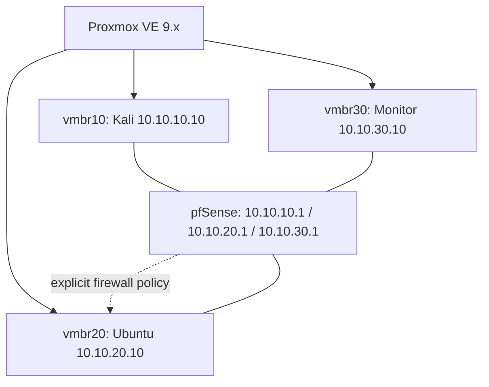
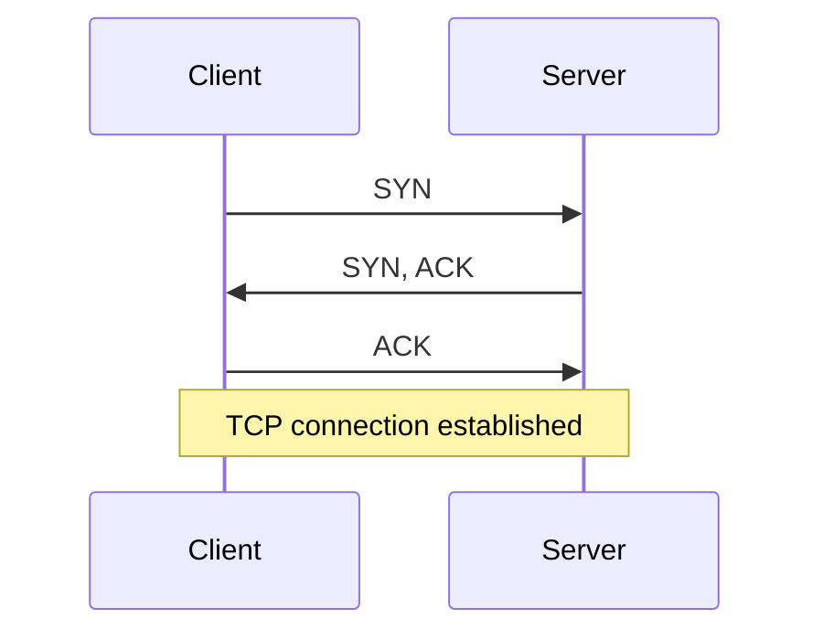
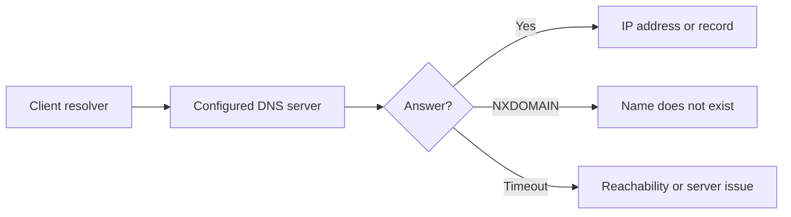
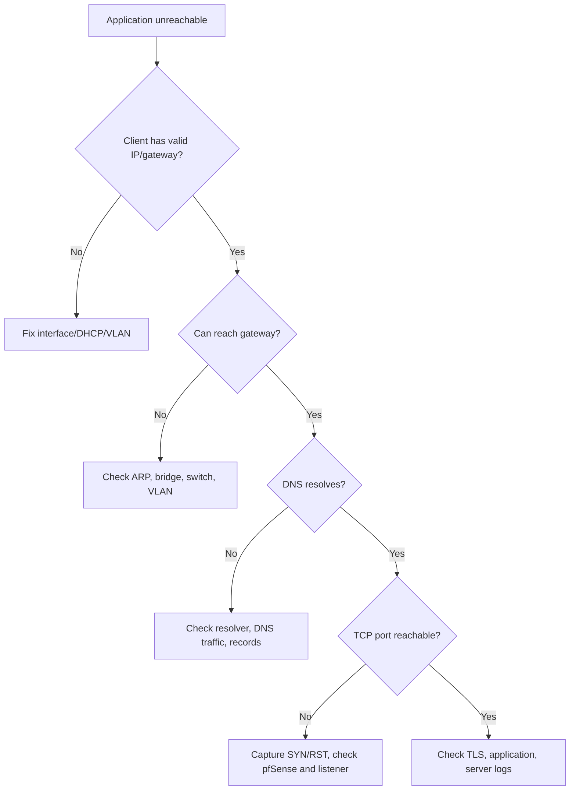

# Wireshark and Essential Network Engineering Applications — Hands-On Guide

**Track:** IT 101 → Expert | **Environment:** Windows 11, Ubuntu, Kali, Proxmox VE 9.x, pfSense | **Audience:** Network and systems engineers, security analysts

> **Authorization and privacy:** Capture and scan only networks and devices you own or are explicitly authorized to assess. Packet captures can contain credentials, personal information, cookies, and business data. Restrict access, redact evidence, and delete captures when no longer needed. Use an isolated lab for intrusive tests.

## Table of contents
1. [Learning objectives](#1-learning-objectives)
2. [Reference lab and architecture](#2-reference-lab-and-architecture)
3. [Tool selection matrix](#3-tool-selection-matrix)
4. [Wireshark installation and first capture](#4-wireshark-installation-and-first-capture)
5. [Wireshark filters and packet interpretation](#5-wireshark-filters-and-packet-interpretation)
6. [TCP and DNS troubleshooting](#6-tcp-and-dns-troubleshooting)
7. [tcpdump and TShark](#7-tcpdump-and-tshark)
8. [Nmap and service discovery](#8-nmap-and-service-discovery)
9. [iperf3, MTR and latency tools](#9-iperf3-mtr-and-latency-tools)
10. [pfSense and Proxmox capture workflows](#10-pfsense-and-proxmox-capture-workflows)
11. [Zeek, Suricata and ntopng](#11-zeek-suricata-and-ntopng)
12. [Zabbix, Grafana, NetBox and logs](#12-zabbix-grafana-netbox-and-logs)
13. [Packet Tracer, GNS3 and EVE-NG](#13-packet-tracer-gns3-and-eve-ng)
14. [Ten practical labs](#14-ten-practical-labs)
15. [Troubleshooting playbook](#15-troubleshooting-playbook)
16. [Evidence and incident report template](#16-evidence-and-incident-report-template)
17. [Completion checklist and resources](#17-completion-checklist-and-resources)

## 1. Learning objectives

By the end you should be able to identify the right tool for a network problem, capture traffic at the correct point, read Ethernet/IP/TCP/UDP/DNS packets, distinguish reachability from application health, test throughput, inspect pfSense firewall behavior, and document a reproducible diagnosis.

## 2. Reference lab and architecture

| System | Address | Network | Purpose |
|---|---|---|---|
| Proxmox host | Existing management IP | Management LAN | Hypervisor; never expose to vulnerable network |
| Kali01 | `10.10.10.10/24` | `vmbr10` | Analyst workstation |
| pfSense LAN1 | `10.10.10.1/24` | `vmbr10` | Kali gateway |
| pfSense LAN2 | `10.10.20.1/24` | `vmbr20` | Target gateway |
| Ubuntu01 | `10.10.20.10/24` | `vmbr20` | Authorized test target |
| pfSense LAN3 | `10.10.30.1/24` | `vmbr30` | Monitoring gateway |
| Monitor01 | `10.10.30.10/24` | `vmbr30` | Monitoring and logs |

**Important:** Separate Proxmox bridges do not route by themselves. pfSense must have an interface in each network and explicitly scoped firewall rules. Do not bridge a vulnerable lab to the production LAN. For initial exercises, keep the lab offline. If you need updates, use a temporary, controlled update path with firewall restrictions, then disconnect it.



## 3. Tool selection matrix

| Tool | Best for | Platform | Example output |
|---|---|---|---|
| **Wireshark** | Visual packet analysis and protocol decoding | Windows, Linux, macOS | Packet list and protocol details |
| **TShark** | Scriptable packet inspection | Windows, Linux | CSV-like fields, JSON, text |
| **tcpdump** | CLI captures on servers and firewalls | Linux, BSD | PCAP file |
| **Nmap** | Authorized host and service discovery | Windows, Linux | Open/closed/filtered ports |
| **iperf3** | Controlled bandwidth tests | Windows, Linux | Mbps/Gbps, retransmits |
| **MTR / WinMTR** | Path, latency and loss investigation | Linux, Windows | Per-hop observations |
| **Zeek** | Network metadata and protocol logs | Linux | `conn.log`, `dns.log`, `http.log` |
| **Suricata** | IDS alerts and network threat detection | Linux, pfSense packages | Alerts and `eve.json` |
| **ntopng** | Traffic visibility and top talkers | Linux | Web traffic dashboards |
| **Zabbix** | Host, SNMP and service monitoring | Linux server + agents | Historical metrics and alerts |
| **Grafana** | Dashboards for metrics/logs from data sources | Multiple | Visual dashboards |
| **NetBox** | IPAM, VLAN and network inventory | Web application | Source-of-truth inventory |
| **Cisco Packet Tracer** | Learning switching/routing | Desktop | Simulated networks |
| **GNS3 / EVE-NG** | Virtual network appliances and topologies | Host/server | Multi-vendor lab |
| **Sysmon + Wazuh** | Endpoint telemetry and centralized analysis | Windows + server | Events and security alerts |

**Choosing quickly:** If a website fails, start with `ping`, DNS lookup, and a TCP port test; use Wireshark when the basic tests do not explain the failure. For performance, use `iperf3`. For ongoing visibility, use monitoring tools rather than leaving Wireshark capturing indefinitely.

## 4. Wireshark installation and first capture

### Windows 10/11
1. Download Wireshark from the official site: <https://www.wireshark.org/download.html>.
2. Run the installer and install **Npcap** when prompted. Npcap enables packet capture on Windows.
3. Launch Wireshark and identify your active Ethernet/Wi-Fi interface by the activity graph.
4. Select the interface, click the blue shark-fin **Start** icon, then generate test traffic.
5. Click the red **Stop** icon and save the capture as `lab01-dns.pcapng`.

### Ubuntu/Kali

```bash
sudo apt update
sudo apt install wireshark tshark tcpdump -y
```

On Debian/Ubuntu, a package configuration prompt may ask whether non-root users can capture. Follow your organization's policy; membership in the capture group grants powerful visibility. Log out/in after any approved group change. Avoid running the entire Wireshark GUI as root.

### First capture: DNS
1. Start a capture on the interface used to reach your **authorized** DNS server.
2. In a separate terminal, run `nslookup example.com` or `dig example.com` (only if your lab has approved DNS connectivity).
3. In the Wireshark **display filter** bar, enter `dns`.
4. Locate the query and response, expand **Domain Name System**, and inspect the query name, record type, response code, and answer.
5. Save the capture; note the timestamp and interface.

**Expected:** A DNS query and response if the configured resolver is reachable. Some modern applications use encrypted DNS, so their lookups may not appear as ordinary UDP/TCP port 53 traffic.

## 5. Wireshark filters and packet interpretation

### Display filters (apply to already captured packets)

| Filter | What it shows |
|---|---|
| `ip.addr == 10.10.20.10` | Packets involving Ubuntu01 |
| `tcp.port == 22` | SSH traffic |
| `udp.port == 53 || tcp.port == 53` | Traditional DNS traffic |
| `dns.flags.rcode != 0` | DNS error responses |
| `tcp.flags.syn == 1 && tcp.flags.ack == 0` | Initial TCP SYNs |
| `tcp.analysis.retransmission` | Packets flagged as retransmissions |
| `icmp` | ICMP packets |
| `arp` | Address Resolution Protocol |
| `http` | Unencrypted HTTP traffic, if present |
| `tls` | TLS records |
| `vlan` | Frames with visible 802.1Q tags |

### Capture filters (set **before** capturing)

```text
host 10.10.20.10
port 53
tcp port 22
net 10.10.20.0/24
not port 22
```

Capture filters use BPF-style syntax and **are not interchangeable** with display filters. Avoid filtering too aggressively during your first diagnosis: you might hide the packet that explains the failure.

### How to read a packet
- **Frame:** capture time, packet length, interface.
- **Ethernet:** source/destination MAC addresses; optional VLAN tag.
- **IP:** source/destination addresses, TTL/hop limit, protocol.
- **TCP/UDP:** source/destination ports; TCP sequence, acknowledgment, flags, window.
- **Application protocol:** DNS question/answer, HTTP status, TLS handshake metadata, etc.

**Privacy:** Do not decrypt, export, or inspect other people's application content without authorization.

## 6. TCP and DNS troubleshooting

### TCP handshake



Common interpretations:
- Repeated SYN without SYN-ACK: destination unreachable, firewall filtering, or response path problem. Confirm from both sides.
- RST from destination: port closed or application actively rejecting.
- SYN/SYN-ACK followed by failure: investigate client firewall, asymmetric routing, middleboxes, or later protocol steps.
- Retransmissions: possible congestion, packet loss, capture artifacts, or application/network delay; correlate with other evidence.

### DNS sequence



Try from Linux:

```bash
ip route
dig @10.10.20.1 example.test
getent hosts example.test
```

Try from Windows PowerShell:

```powershell
Get-DnsClientServerAddress
Resolve-DnsName example.test -Server 10.10.20.1
Test-NetConnection 10.10.20.10 -Port 22
```

`example.test` is illustrative; configure the record in your lab DNS before expecting a successful answer.

## 7. tcpdump and TShark

### Find the capture interface

```bash
ip -br link
sudo tcpdump -D
```

### Capture authorized SSH traffic to a file

```bash
sudo tcpdump -ni ens18 -s 0 -c 100 -w ssh-lab.pcap 'host 10.10.20.10 and tcp port 22'
```

Replace `ens18` with your actual interface. `-c 100` stops after 100 matching packets; press Ctrl+C sooner if needed. Open `ssh-lab.pcap` in Wireshark.

### Read capture metadata with TShark

```bash
tshark -r ssh-lab.pcap -q -z io,phs
tshark -r ssh-lab.pcap -T fields -e frame.time -e ip.src -e ip.dst -e tcp.dstport
```

### Rotate captures to limit disk usage

```bash
sudo tcpdump -ni ens18 -s 0 -G 60 -W 5 -w 'lab-%Y%m%d-%H%M%S.pcap' 'host 10.10.20.10'
```

Stop after the planned exercise. `-G` and `-W` behavior can vary by version; verify capture rotation on your installation and monitor free disk space. Never capture indefinitely on a production server.

## 8. Nmap and service discovery

Use only against your own or explicitly authorized hosts.

```bash
sudo apt install nmap -y
nmap -sT -p 22,80,443 10.10.20.10
nmap -sV -p 22,80,443 10.10.20.10
```

**Interpretation:** `open` means the scan observed a service accepting connections; `closed` means the host rejected the probe; `filtered` means filtering or lack of a conclusive response. An open port does not by itself prove a vulnerability. Compare results to the server's `ss -lntup` output and pfSense rules.

## 9. iperf3, MTR and latency tools

### Throughput: two machines you control

On Ubuntu target:

```bash
sudo apt install iperf3 -y
iperf3 -s
```

On Kali:

```bash
iperf3 -c 10.10.20.10 -t 10
iperf3 -c 10.10.20.10 -R -t 10
```

The second command tests the reverse data direction. Allow TCP port 5201 only between the two lab VMs during the test. Virtualized throughput reflects host resources and virtual networking; it is not automatically a measure of physical internet speed.

### Path and latency

```bash
ping -c 5 10.10.20.10
traceroute 10.10.20.10
mtr -rw -c 20 10.10.20.10
```

On Windows:

```powershell
ping 10.10.20.10
tracert 10.10.20.10
pathping 10.10.20.10
```

A router may deprioritize ICMP replies while forwarding normal traffic correctly. Interpret per-hop loss cautiously; sustained end-to-end loss matters more.

## 10. pfSense and Proxmox capture workflows

### pfSense
1. Log in to the pfSense web GUI from an authorized administration network.
2. Open **Diagnostics → Packet Capture** (menu labels can vary by release).
3. Choose the interface on which you expect the packet to arrive.
4. Set a narrow host or port filter, start capture, reproduce the issue, then stop.
5. Download the PCAP and open it in Wireshark.
6. Compare the result with **Status → System Logs → Firewall** and the matching interface's firewall rules.

**Interpretation:** A packet arriving on the Kali-facing interface but not leaving the target-facing interface can indicate a firewall/routing decision. Also check NAT, interface assignments, routes, and whether the target has a return route. Captures taken at different points may show different packet headers because of NAT.

### Proxmox

```bash
ip -br link
bridge link
qm config 120
sudo tcpdump -ni vmbr20 -c 50 'host 10.10.20.10'
```

Replace VM ID `120` and bridge name with your real values. If a VM uses a VLAN-aware bridge, verify its VM NIC `tag=` setting and upstream switch trunk. Linux offloading can make checksum warnings or packet sizes look surprising in captures; cross-check from another capture point before assuming corruption.

## 11. Zeek, Suricata and ntopng

### Zeek
Zeek turns observed traffic into structured logs such as connection, DNS, and HTTP metadata. It is especially useful for investigations and baselining. Deploy it on a dedicated monitoring VM and provide traffic via a supported mirror/TAP mechanism. A separate VM connected to the same Linux bridge does **not** automatically receive all other VMs' unicast traffic.

Official documentation: <https://docs.zeek.org/>

### Suricata
Suricata is an intrusion detection/prevention engine that can generate alerts from mirrored traffic or inspect traffic inline when deliberately configured. Begin in **IDS/alert-only mode** in your isolated lab; enable blocking only after reviewing false positives and rollback options.

Official documentation: <https://docs.suricata.io/>

### ntopng
ntopng provides traffic dashboards and top talkers. Like Zeek, it needs traffic visibility through the appropriate interface, flow export, or mirroring. Do not assume installing it on any VM reveals all traffic.

Official documentation: <https://www.ntop.org/products/traffic-analysis/ntop/>

## 12. Zabbix, Grafana, NetBox and logs

- **Zabbix:** monitor host availability, CPU, memory, disk, interfaces, and services; optionally poll managed network devices with SNMPv3. <https://www.zabbix.com/documentation/current/en/manual>
- **Grafana:** visualize metrics and logs supplied by configured data sources (for example, Prometheus or Loki). Grafana is not itself a packet capture engine. <https://grafana.com/docs/>
- **NetBox:** maintain IP addresses, prefixes, VLANs, racks, devices, and interface assignments as a source of truth. <https://netboxlabs.com/docs/netbox/>
- **Windows Sysmon and Wazuh:** collect endpoint and security event telemetry. Sysmon logs activity on Windows; Wazuh can centralize endpoint security events. <https://learn.microsoft.com/sysinternals/downloads/sysmon> and <https://documentation.wazuh.com/>

**Suggested progression:** Wireshark → tcpdump/TShark → iperf3/Nmap → pfSense logs → Zabbix/NetBox → Zeek/Suricata.

## 13. Packet Tracer, GNS3 and EVE-NG

| Application | When to use it | Notes |
|---|---|---|
| Cisco Packet Tracer | Learn switch VLANs, trunks, routing and CLI | Simulated device behavior; not identical to hardware |
| GNS3 | Test multi-vendor virtual networking | Requires images/licenses you are entitled to use |
| EVE-NG | Build multi-node virtual labs | Resource-intensive; appliance images have licensing constraints |

Resources: <https://www.netacad.com/cisco-packet-tracer>, <https://docs.gns3.com/>, <https://www.eve-ng.net/index.php/documentation/>.

For packet captures in simulations, use the platform's capture feature on the relevant link. Compare simulated observations with your Proxmox/pfSense lab.

## 14. Ten practical labs

For each lab, record **goal → topology → command or GUI action → expected result → actual result → conclusion → remediation → retest**.

### Lab 1 — First DNS capture
Capture a DNS query with Wireshark. Identify source IP, destination resolver, transaction ID, query type, response code, and answer. **Pass:** Explain what happened in five sentences.

### Lab 2 — TCP three-way handshake
Start a temporary SSH connection from Kali to an authorized Ubuntu VM. Filter `tcp.port == 22` and locate SYN, SYN-ACK, ACK. **Pass:** Label source/destination ports and flags.

### Lab 3 — Closed port vs filtered port
Test a known closed TCP port and a deliberately firewall-blocked port on your lab target. Compare Nmap results, Wireshark, and pfSense logs. **Pass:** Explain why the outcomes differ.

### Lab 4 — DNS failure
Temporarily point a lab client to a nonexistent DNS resolver, run a lookup, capture packets, restore the original setting, and retest. **Pass:** Show before/after evidence.

### Lab 5 — pfSense rule diagnosis
Create a narrowly scoped temporary deny rule between Kali and the Ubuntu test service, capture traffic on both interfaces, inspect firewall logs, then restore the approved rule. **Pass:** Demonstrate the exact rule causing the denial.

### Lab 6 — Throughput baseline
Run `iperf3` in both directions between two lab VMs. Record throughput, retransmissions, VM CPU load, and test duration. **Pass:** Explain at least two limits on measured throughput.

### Lab 7 — VLAN mismatch
On a **non-production** test VM, deliberately assign an incorrect VLAN tag in Proxmox, verify loss of connectivity, then restore the correct tag. **Pass:** Capture VM NIC settings and the successful retest. Avoid changing the management bridge.

### Lab 8 — ARP and gateway
Clear a lab client's neighbor cache using the OS-appropriate command, ping its gateway, and capture ARP traffic. **Pass:** Identify ARP request and reply. (On routed links, ARP resolves the local gateway, not the remote target.)

### Lab 9 — Network monitoring
Install a monitoring agent on one authorized VM, build a CPU/memory/disk availability view in Zabbix or another monitoring stack, and trigger a harmless test alert. **Pass:** Record the alert and recovery timestamps.

### Lab 10 — Mini incident response
Simulate a web service failure by stopping a test web server on Ubuntu. Diagnose from Windows or Kali using DNS, TCP port test, packet capture, service status, and logs. Restart the service and document root cause. **Pass:** Provide a reproducible incident report.

## 15. Troubleshooting playbook



| Symptom | Start with | Then inspect |
|---|---|---|
| No IP address | `ipconfig /all`, `ip addr` | DHCP exchange, VLAN, bridge |
| Can ping IP, not name | `nslookup`, `dig` | DNS query/response in Wireshark |
| SSH timeout | TCP port test | SYN path, firewall logs, routes |
| SSH refused | `ss -lntup` on server | TCP RST, service status |
| Slow transfers | `iperf3` | Retransmissions, CPU, MTU, duplex, congestion |
| Some VMs cannot communicate | `qm config`, `bridge link` | VM bridge/VLAN and pfSense rules |
| IDS sees no traffic | Sensor NIC/visibility | Mirror/TAP or flow export configuration |

## 16. Evidence and incident report template

```markdown
# Network Incident Report
- Incident ID:
- Date/time/time zone:
- Reporter:
- Authorized systems in scope:
- User impact:
- Network topology and addresses:
- Symptoms and first detection:
- Tests performed (commands, interfaces, timestamps):
- Packet capture filename and secure storage location:
- Observed evidence:
- Root cause (confirmed / suspected):
- Corrective action:
- Retest results:
- Prevention/monitoring follow-up:
- Owner and closure date:
```

Do not commit raw PCAPs, credentials, private keys, session cookies, or sensitive logs to a public GitHub repository. Use sanitized screenshots and synthetic sample data.

## 17. Completion checklist and resources

- [ ] Installed Wireshark and identified the correct capture interface.
- [ ] Distinguished capture filters from display filters.
- [ ] Identified TCP SYN, SYN-ACK, ACK and RST.
- [ ] Captured and interpreted a DNS lookup.
- [ ] Saved and opened a PCAP/PCAPNG file.
- [ ] Used tcpdump and TShark for a CLI capture.
- [ ] Tested a known authorized service with Nmap.
- [ ] Measured throughput with iperf3.
- [ ] Correlated pfSense firewall logs with packet captures.
- [ ] Verified Proxmox bridge/VLAN settings without changing management access.
- [ ] Understood how network sensors receive mirrored traffic.
- [ ] Completed ten labs and documented at least one incident.

### Official resources
- Wireshark User's Guide: <https://www.wireshark.org/docs/wsug_html_chunked/>
- Wireshark Display Filter Reference: <https://www.wireshark.org/docs/dfref/>
- Nmap Reference Guide: <https://nmap.org/book/man.html>
- iperf3: <https://software.es.net/iperf/>
- Proxmox VE Documentation: <https://pve.proxmox.com/pve-docs/>
- pfSense Documentation: <https://docs.netgate.com/pfsense/en/latest/>
- Zeek Documentation: <https://docs.zeek.org/>
- Suricata Documentation: <https://docs.suricata.io/>

---

**Suggested GitHub path:** `networking/wireshark-and-network-apps/README.md`

**Next module:** Network monitoring and detection engineering: SPAN/mirror ports, NetFlow/IPFIX, SNMPv3, syslog, Zeek logs, Suricata alerts, and Grafana dashboards.
